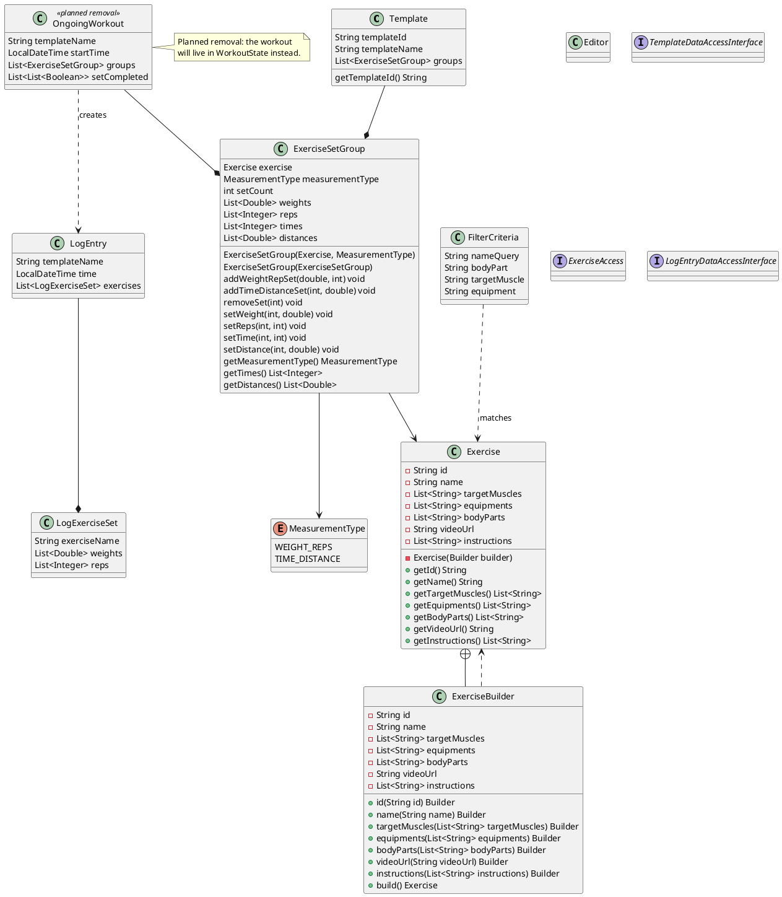

# Team Project

Please keep this up-to-date with information about your project throughout the term.

The readme should include information such as:
- a summary of what your application is all about
- a list of the user stories, along with who is responsible for each one
- information about the API(s) that your project uses 
- screenshots or animations demonstrating current functionality

By keeping this README up-to-date,
your team will find it easier to prepare for the final presentation
at the end of the term.

# frutiger aero yams OW Workouts

## Team Information
### Team Members
- Terry Zhu
- William Li
- Tian Qi
- Denise Ma

## Project Description
### Domain: Fitness and Health Technology
An app that allows a user to search for exercises and create workouts.

## User Stories
### As a new gymgoer, I want to discover new exercises by muscle group or equipment so that I can more easily target the muscle I want to train.
### As an injured gymgoer, I want to cross reference my form against a reputable database so that I can safely perform exercises without worsening my injury.
### As an athlete, I want to track my working weights over time so I can make sure I’m on the path to reaching sport-specific goals.
### As a fitness trainer, I want to easily share a customized workout plan with a client so that I can send updated weekly routines in bulk without spending time manually texting/emailing them.
### As a general user, I want to quickly compile a workout routine I saw online so that I can follow it in my gym session.

## Use Cases
### Query database for exercises
### Import / export exercise template
### Use exercise template during a workout
### Log exercises completed during a workout

## MVP

| Team Member | MVP Use Case|
|---------------------|---------------------|
| Terry | Database |
| Denise | Use exercise template during workout & save to log |
| Tianqi | Create and save template outside workout |
| William | Import/export template as JSON |

---
## Entities
### Exercise
An immutable exercise from ExerciseDB: id, name, target muscles, equipment, body parts, video URL and instructions.

### ExerciseSetGroup
One exercise occurrence within a template, with a `MeasurementType` of `WEIGHT_REPS` or `TIME_DISTANCE`. Each set has either a weight and rep count, or an integer time and double distance. Sets can be added, removed or edited through the matching methods. The active measurement lists remain aligned; unused lists are empty. The copy constructor copies both the type and set values so changes to a copied group do not affect the original.

### Template
A reusable workout plan with a stable string `templateId`, an editable name, and an ordered list of `ExerciseSetGroup`s. New templates receive UUID strings; loading an existing template preserves its ID. Renaming a template does not change its identity.

### MeasurementType
The shared enumeration `WEIGHT_REPS` or `TIME_DISTANCE`, chosen per exercise group. Operations for the wrong measurement type are rejected. Measurement units and numeric ranges still need team agreement.

### OngoingWorkout (Planned for removal)
A workout in progress, started from a `Template` at a recorded start time. It works on copies of the template's groups and tracks whether each set is completed. Sets can be added, removed or updated mid-workout. `toLogEntry()` turns the workout into a `LogEntry` that keeps only the completed sets.

### LogEntry
An immutable record of a finished workout: the template name, the date and time (`LocalDateTime`), and a list of `LogExerciseSet`s.

### LogExerciseSet
An immutable record of the sets actually performed for one exercise: the exercise name and matching lists of weights and reps.

### FilterCriteria
Optional search filters for exercises: name (matches any part of the name), body part, target muscle and equipment. `matches(Exercise)` ignores case and skips empty criteria.

### Editor
(TBD)

### Template editor draft data (use-case layer)
Template creation shares `entities.Template`, `entities.ExerciseSetGroup`, and `entities.Exercise` with import/export. The current data-access interface continues to look templates up by name while preserving their stable IDs.

The editor keeps unfinished input in immutable `WorkoutTemplateDraft`, `DraftExerciseGroup`, and `DraftSet` snapshots under `use_case.edit_template_draft`. Each draft group records its measurement type, and draft sets hold weight, reps, time, and distance as text. Each exercise occurrence has a temporary row UUID so repeated exercises can be edited independently. `EditTemplateDraftInteractor` creates a new snapshot after each edit and preserves the template ID when editing an existing plan.

`SaveTemplateInteractor` validates the name and the selected measurement pair for each set, converts the draft into a shared `Template`, and calls `TemplateDataAccessInterface.save`. It rejects name collisions between different templates and reports success after the JSON write completes.

Template JSON preserves `templateId`, `measurementType`, and all four measurement lists. Older files without IDs or measurement types load as weight/rep templates with stable fallback IDs derived from their unique names; saving writes the new fields. Loading alone does not rewrite the file. Saving a renamed template removes its previous name entry using its ID.
---
## API Usage
**ExerciseDB**
**Documentation:** Link
**How it is used in the program:**
---
## Design Diagrams
### UML Class Diagram

###. Sequence Diagrams
---
## How to Run
[Instructions for running the program.]
---
## Notes
See [specification.md](specification.md) for the package layout.
